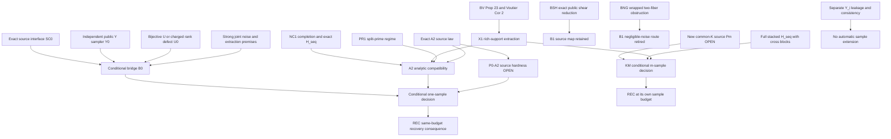

# Dependency diagram, version G2

Arrows show mathematical dependence, not evidence of source hardness. Exact statements, versions and critic dispositions are in claims.json. New derivations remain provisional until fresh criticism. Original inputs are preserved in the portfolio-gate snapshot.

The bridge is a conditional implication: its proof can be accepted while P0-A2 remains open. A2 analytic feasibility combines one specified d,q,F,H,G law; it is not the stronger claim of a supported computational construction. Uniform-U HLBDD and active-U A2 are different sources. B1's inherited source map and A2's noise cannot be combined.

For m samples, KM needs the new common-K source, full vector noise comparison and one full retained extraction statement. It does not tensor one-sample copies. Search conversion is separate: same-budget verification needs no held-out samples in the baseline, whereas held-out verification consumes additional independent samples.

Source or auxiliary changes reopen statistical premises and computational assumptions. Critic-induced changes must list downstream dispositions in reconciliation.md and the ledger history. No formal proof certificate is claimed.
