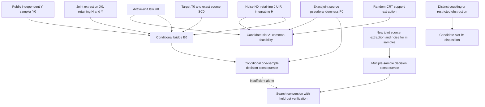

# Dependency diagram, version G0

Every node is initially OPEN. Changes to a source law or noise/auxiliary hypothesis reopen dependent claims. Exact statements, evidence labels, versions and reviewer dispositions are maintained in `claims.json`; frozen snapshots precede criticism. An assumed source node remains an assumption even if the bridge is checked.
